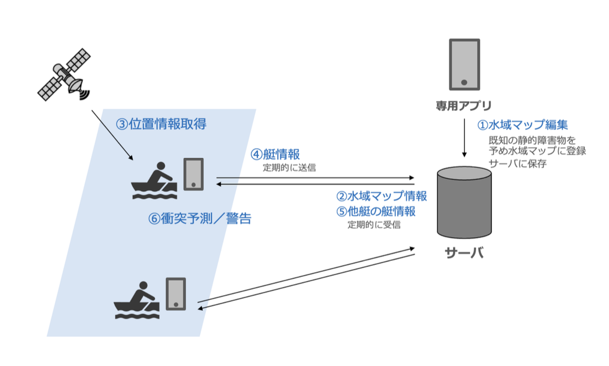

# 設計書

> この文書は「何があるか」を記述する仕様書です。
> **「何を前提に、何を優先して作るか」は [DESIGN_PRINCIPLES.md](DESIGN_PRINCIPLES.md)(設計原則)** にあります。
> 設定値の変更・機能追加・警告挙動の変更を検討する場合は、先にそちらを読んでください。
>
> ファイル単位の地図(安全経路の各ファイルの役割)と警告の鳴り方の規則は
> [CLAUDE.md](../CLAUDE.md) の「アーキテクチャ」「衝突警告の仕組み」「提示ポリシー」にあります。
> この文書では同じ表を繰り返さず、全体の形だけを書きます(2か所に書くと食い違うため)。
>
> 2026-10-24 に実装へ合わせて書き直した。それ以前の版は修士研究時点の構成
> (Firestore での位置共有・4艇種・地磁気方位)を記述していた。

## 1. 概要

### 1.1. プロジェクト概要

Rowing Navigator はローイングの安全な航行を支援するアプリです。
艇の航行状況や危険な水域をマップ上にリアルタイムに可視化し、他艇や危険な水域への接近を検知して音声による衝突警告を行います。

本アプリは、大羽俊輔の修士研究において開発されました。修士論文は[こちら](https://github.com/obashun22/master_thesis)からご覧いただけます。
桜川版は、それを茨城県土浦市の桜川での練習向けに作り直したものです。運用前提(川幅・右側通行・艇数など)は
[DESIGN_PRINCIPLES.md](DESIGN_PRINCIPLES.md) 第1章にあります。

### 1.2. 技術スタック

#### 1.2.1. 主なライブラリ(`pubspec.yaml`)

| カテゴリ | ライブラリ | 用途 |
| --- | --- | --- |
| アプリ基盤 | Flutter, Dart | iOS / Android |
| 状態管理 | flutter_hooks, hooks_riverpod | フックベースの状態管理 |
| 地図・位置 | google_maps_flutter, geolocator, flutter_map_math | 地図表示、GPS測位、地理計算 |
| 通信 | firebase_core, firebase_auth, firebase_database, cloud_firestore, firebase_app_check | 匿名認証、位置共有(RTDB)、危険区域・チーム情報(Firestore)、不正利用抑止 |
| センサ | sensors_plus, battery_plus | ストロークレート(加速度)、電池残量の共有 |
| 音声 | audioplayers | 事前生成した読み上げ音声の再生 |
| 端末制御 | wakelock_plus | 航行中だけ画面を点灯し続ける(`lib/hooks/use_screen_wakelock.dart` だけが呼ぶ) |
| 保存・共有 | shared_preferences, path_provider, share_plus, archive | 設定・練習記録の端末内保存、GPX/CSV/ZIP の共有 |
| 計算 | vector_math, crypto, rxdart | 幾何計算、危険区域データのハッシュ検証、ストリーム処理 |

端末の地磁気方位(コンパス)は使わない。針路はGPSで観測した移動方向から推定する。

#### 1.2.2. 外部サービス

| サービス | 用途 |
| --- | --- |
| Google Maps Platform | 地図表示 |
| Firebase Authentication | 匿名認証(画面には出さない) |
| Firebase Realtime Database | 航行中の位置共有、チーム所属の写し |
| Cloud Firestore | チーム・招待コード・メンバー、臨時危険区域、固定危険区域の位置調整・警告設定 |
| Firebase App Check | 非正規アプリからの利用の抑止(テスト運用中は監視のみ) |

### 1.3. 開発環境

動作確認した版は [README.md](../README.md)「サポートバージョン」と [ios_build.md](ios_build.md) 2章にあります。

## 2. システムアーキテクチャ

### 2.1. 全体構成



(修士研究時点の構成図。現在は位置共有に Firestore ではなく Realtime Database を使い、
危険区域の基準形状はアプリに同梱している。)

### 2.2. レイヤー構成

```
┌─────────────────────────────────────┐
│ Presentation  screens/ features/    │ ← 画面・UI
├─────────────────────────────────────┤
│ Hooks         hooks/                │ ← 状態管理・処理の組み立て
├─────────────────────────────────────┤
│ Services      services/             │ ← 安全判定(純Dart)・外部連携
├─────────────────────────────────────┤
│ API           api/                  │ ← Firebase 通信
├─────────────────────────────────────┤
│ Models        models/ types/        │ ← データモデル・列挙型
└─────────────────────────────────────┘
```

設定値はすべて `lib/config/` に集約する(コメントに根拠を書く)。地図の配色・重なり順は `lib/theme/`。

中核は `lib/hooks/use_navigator.dart` で、GPSストリーム → 品質選別 → 推定 → リスク評価 → 提示 →
記録 → 適応送信 を毎秒回す。安全判定の部品は `lib/services/` の純Dartクラスに切り出し、
単体テストを付けている。各ファイルの役割は CLAUDE.md の表を参照。

### 2.3. 主な画面(`lib/screens/`)

| 画面 | ファイル | 役割 |
| --- | --- | --- |
| 地図(待機・航行・監視) | `home_map_screen.dart` | 1つの地図画面が、待機中・航行中・監視中の3つの状態を持つ。「メニュー」から各画面へ入る |
| 起動時の振り分け | `app_entry_gate.dart` | チーム参加・名前登録が済んでいなければ、地図の前に出す(通信を待たない) |
| チーム参加・管理 | `team_onboarding_screen.dart`, `team_screen.dart` | チーム作成・招待コード参加、メンバー一覧・管理者交代・招待コード更新 |
| 名前の登録 | `display_name_registration_screen.dart` | アカウントの名前(同名可・20文字以内) |
| 危険区域の編集 | `area_setting_screen.dart` | 臨時危険区域の追加・編集・削除(7日間は元に戻せる)、固定流木の位置・大きさの更新 |
| 既設危険区域の調整 | `fixed_obstacle_calibration_screen.dart`, `fixed_obstacle_warning_settings_screen.dart` | 同梱の危険区域の位置合わせ、警告対象からの除外 |
| 練習記録 | `record_list_screen.dart`, `record_replay/` | 航行ごとの記録一覧・リプレイ・GPX/CSV出力 |
| 練習一括ログ | `practice_log_list_screen.dart` | 監視端末が記録した全艇のログ(ZIPで共有) |
| ワークアウト | `workout_setup_screen.dart` | メニューの登録・準備 |
| 端末とデータ | `device_status_screen.dart`, `privacy_data_screen.dart` | GPS・安全機能の状態、プライバシー、アカウントとデータの削除 |
| 使い方 | `first_run_guide_screen.dart`, `usage_guide_screen.dart`, `usage_guide/` | 初回案内と使い方ガイド |

## 3. バックエンド設計

正本はリポジトリ直下の `database.rules.json` と `firestore.rules`。Rules の Emulator テストは
`firebase_rules_test/` にあり、CI の `firebase-rules` ジョブが毎回実行する。

### 3.1. Realtime Database

| パス | 中身 |
| --- | --- |
| `teams/{teamId}/live_positions/{uid}` | 航行中の位置・針路・速度・電池残量など。12艇が12艇ぶんを購読するので、ここへ足したバイト数は144倍で効く |
| `teams/{teamId}/boat_profiles/{uid}` | 航行中の名前・艇種 |
| `teams/{teamId}/stroke_traces/{uid}` | 1ストロークの艇速波形(表示専用。監視端末が開いた1艇だけ購読する。不変条件13) |
| `team_meta` / `team_invites` / `team_users` / `team_members` | Firestore のチーム情報の写し(RTDB Rules から所属を確かめるため) |

位置・名前は航行終了時と接続切断時(`onDisconnect`)に消す。

### 3.2. Firestore

| パス | 中身 |
| --- | --- |
| `teams/{teamId}` | チーム名・管理者など |
| `teams/{teamId}/members/{uid}` | 所属と参加時刻、アカウントの名前(`displayName`) |
| `users/{uid}` / `invite_codes/{code}` | 所属の逆引き、招待コード |
| `teams/{teamId}/temporary_obstacles/{id}` | 臨時危険区域。削除は `deletedAt` の印を付けるだけで、7日間は元に戻せる |
| `teams/{teamId}/managed_hazards/…` | 固定流木の変形値、既設危険区域の位置調整・警告設定・警告の鳴り始め(チーム共有) |

旧版の `messages` / `static_obstacles` / グローバルの `temporary_obstacles` / `managed_hazards` は Rules で拒否する。

### 3.3. 認証

Firebase Authentication の**匿名認証**を画面には出さずに使う。チーム作成または招待コード参加の
ときに一度だけ作り、以後は保存済みの UID と所属を起動時に復元する。

## 4. 機能設計

### 4.1. 地図表示

地図は層で読む。**塗り = 実在する危険**、**実線 = 実在するものの輪郭**、
**破線 = 越えない取り決め**(航路の中央線)、**線 = これから通る予測**(自艇・他艇の船体領域と掃引外形)。
航路は中央線1本だけを描き、往路・復路の帯は描かない。配色と重なり順(`zIndex`)は
[`lib/theme/map_layer_spec.dart`](../lib/theme/map_layer_spec.dart) に集約している。

航行中は、漕手が後ろ向きに座ることに合わせて地図を進行方位 +180度で回す。**進行方向は画面の下**で、
自艇は画面のやや上(`navigationSelfBoatScreenRatio` = 0.45)に置き、下側を前方の見通しに使う。
既定倍率は待機中 18.0 / 航行開始時 19.0 / 監視開始時 16.5 で、各モードの開始時に1回だけ適用する
(`lib/config/map_style_config.dart`)。

艇の色は、航行中は自艇＝赤・他艇＝濃い青みグレーで、艇ごとに色分けしない。監視中だけ艇ごとの識別色を使う
(`lib/theme/boat_palette.dart`)。

### 4.2. 衝突警告

自艇の将来経路(航路中心線に沿った折れ線)を連続的に掃引し、他艇・危険区域と重なる時刻を求める。
他艇は相対速度で掃引する。内部レベル(どれだけまずいか)と鳴り始め(どれだけ切迫しているか)は分けて扱う。
警告は事前生成の読み上げ音声(VOICEVOX:ずんだもん)で、対象ごとに別の音声を使う。
詳細は CLAUDE.md の「衝突警告の仕組み」「提示ポリシー」、設定値の根拠は DESIGN_PRINCIPLES.md 第3章。

### 4.3. 位置共有

適応送信: 停止中10秒 / 周囲300mに他艇なし5秒 / 他艇近傍・リスク時・他艇を受信できない間は2秒。
リスク評価は送信間隔と無関係に毎秒行う。受信側は最大6秒まで推測航法で外挿し、30秒で他艇を消す。

### 4.4. 危険区域

固定危険区域は `assets/data/sakuragawa_obstacles.json` に同梱し、Firestore には保存しない
(位置調整の差分だけをチームで共有する)。岸は基準線から長方形の区域へ展開される。
臨時危険区域はアプリ内で描き、同じチームの全員が編集・削除できる。

### 4.5. 監視と記録

- 監視: 「監視スタート」を押した端末が全艇の航跡・艇一覧・異常(長時間停止・更新途絶)を表示する。
  監視中は画面の常時点灯をしない。全艇のログを端末内に記録し、ZIPで共有する(サーバー送信なし)。
- 練習記録: 航行終了時に端末内へ保存し、距離・スプリット・ピースを解析する。GPX(Strava互換)・CSVで出力できる。

## 5. データ設計

### 5.1. 艇種(`lib/types/boat_type.dart`)

`r_1x`, `r_2m`(2-), `r_2x`, `r_2p`(2+), `r_4m`(4-), `r_4x`, `r_4p`(4+), `r_8p`(8+)。
寸法・停止距離は漕手の人数(`sizeClass`)で共有し、2-/2+ は 2x、4-/4+ は 4x と同じ値を使う。
位置共有の `boatType` には区分を、本当の艇種は `boatClass` で送る(旧版は知らない名前を 1x として読むため)。

### 5.2. 危険区域の種類(`StaticObstacleKind`)

`generic`(アプリ内で描いた臨時危険区域など), `shore`, `bridge`, `bridgePier`, `island`, `driftwood`, `pile`,
`curve`, `reverse`, `testZone`(陸上試験用。release では読み込まない)。

## 6. セキュリティ

- チーム所属は Rules で強制する(未認証・未所属・別チーム・他UIDの位置の書き込みを拒否)。
- API キー・秘密情報はコードに直書きしない(`android/secret.properties`・`ios/Flutter/Secrets.xcconfig`)。
- データの取扱いは [store/データ取扱い台帳.md](store/データ取扱い台帳.md) にまとめてある。

## 7. テスト

`flutter test` の単体・統合テストと、Rules の Emulator テストを CI(`.github/workflows/ci.yml`)で毎回実行する。
実データ(`assets/data/sakuragawa_obstacles.json`)を使う統合テストは、設定値の意図と実効値のずれを
検出する唯一の手段なので必ず維持する。実機・水上での確認は CI では代替できない。

## 用語集

| 用語 | 説明 |
| --- | --- |
| GNSS | 全球測位衛星システム。GPS などの衛星測位システムの総称 |
| 静的障害物(危険区域) | 位置が固定されている危険。岸・橋・橋脚・杭・中州・流木など |
| 動的障害物 | 位置が変化する障害物。他艇 |
| 船体領域 / 排他領域 | 艇そのものの範囲 / 他艇に空けてほしい範囲(`shipBody` / `exclusive`) |
| 衝突リスクレベル | lv0〜lv3。どれだけまずいかを表し、表示色・優先順位・ログにだけ使う |
| 鳴り始め | 到達予測までの残り秒数がこれ以下になったら音を鳴らす値。確実な当たりは13秒、確度の低い当たりは10秒 |
| 航行 / 監視 | 艇に積んで漕ぐ使い方 / 陸上から全艇を見る使い方(コード上は navigator / observer) |
| system fault | GPS途絶・受信途絶・評価停止など、能力の低下。表示だけで音は鳴らさない |
| メッセージ | 艇情報を送受信する際のデータ型。AIS のメッセージをイメージして命名 |
